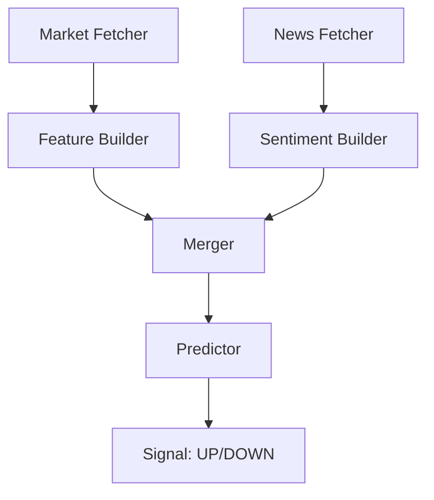

# SOL/USDT Classification & Prediction Module

## 📌 Overview
The Classification module is a machine-learning supervised learning system designed to predict the price direction of Solana (SOL/USDT). It functions as a temporal feature-fusion engine, combining technical market indicators with sentiment signals to determine if the price will move **UP** or **DOWN** over the next hour.

---

## ⚙️ Full Pipeline Steps
1. **Collection**: Fetches 15m OHLCV data via Binance/CCXT.
2. **Engineering**: Computes 47 technical indicators (Momentum, Volatility, Trend).
3. **Merging**: Integrates sentiment features from the NLP module.
4. **Sequencing**: Groups the window into 32-timestep sequences (8-hour sliding windows).
5. **No-Leak Processing**: Purges target-related features and fits the scaler *only* on training data.
6. **Inference**: Predicts probabilities using a trained **XGBoost** model.

---

## 📂 Files and Their Roles
- `01_collect_sol_data_15m.py`: Historical market data downloader.
- `02_build_technical_features.py`: Core indicator engineering logic.
- `06_merge_sentiment_features.py`: Offline merger of technical and NLP CSVs.
- `07_prepare_no_leak_data.py`: **Critical Script** that enforces data integrity, handles the train/val/test split, and saves the `feature_columns.json` registry.
- `08_train_xgboost_no_leak.py`: Training script for the binary direction classifier.
- `realtime_market_fetcher.py`: Live data polling with ccxt.
- `realtime_feature_builder.py`: Real-time replication of indicators.
- `realtime_merge_features.py`: Live technical + sentiment fusion.
- `realtime_predictor.py`: The final inference script that outputs the probabilistic signal.

---

## 🚨 The Data Leakage Problem
### The "82% Accuracy" Mirage
Earlier versions of this system reported 80%+ accuracy. Upon investigation, this was identified as **Data Leakage**:
1. **Target Infiltration**: Features like `future_return` were accidentally kept in the training set. The model was effectively "reading the answer."
2. **Global Scaling**: The scaler was fitted on the *entire* dataset. This meant the training set had "knowledge" of the maximum/minimum prices in the future test set.

### The "No-Leak" Fix
The current pipeline implements strict guardrails:
- **Purge Regex**: Any column containing `future`, `target`, `lead`, or `t+1` is automatically dropped from the feature set.
- **Sequential Scaling**: Scalers are now fitted **only on the training split**. 
- **Chronological Split**: Data is never shuffled. Training always precedes Validation, which precedes Testing.

---

## 📊 Offline Results
- **Current AUC**: ~0.50 - 0.52.
- **Why are results weak?**
  - **Low Signal-to-Noise**: 15-minute price action is heavily influenced by random walk and microstructure noise.
  - **Feature Limitation**: OHLCV alone does not capture the "Liquidity" or "Order Flow" dynamics that drive price.
  - **Sentiment Sparsity**: News events are discrete; sentiment provides no signal for ~70% of the buckets.

---

## 🚀 Real-Time Pipeline

- **Registry Alignment**: The predictor loads `feature_columns.json` to ensure that if new features are added to training, the real-time system automatically zero-fills gaps to maintain alignment.
- **Sequence Reconstruction**: It takes the latest 32 rows of merged data to form the input tensor.

---

## 📉 Limitations
- **Predictive Horizon**: 15-minute prediction is high-noise.
- **Missing Data**: No Order Book Depth (L2) or Funding Rates.
- **Single Model**: Relies solely on XGBoost without an ensemble or deep learning (GNN) layer.

---

## 🔮 Next Steps
- **Better Targets**: Implement **H4, H8, and H16** targets. Longer horizons are generally smoother and easier to predict than 15-minute noise.
- **SHAP Interpretation**: Use SHAP values to identify which technical indicators (e.g., RSI vs ATR) are actually predictive.
- **Order Book Features**: Incorporate Bid/Ask spread, imbalance, and depth.
- **TimescaleDB Integration**: Migrate from CSV to a time-series database for backtesting and performance tracking.
- **Reddit Sentiment**: Incorporate r/solana sentiment to complement GDELT news.
