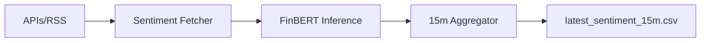

# NLP & Sentiment Analysis Module

## 📌 Overview
The NLP (Natural Language Processing) module is the sentiment extraction engine of the Solana AI Trading System. Its primary objective is to quantize unstructured text data from global news and social media into high-fidelity numeric signals. These signals allow the classification model to understand market psychology and anticipate volatility driven by fundamental news events.

---

## ⚙️ Full Pipeline Steps
1. **Ingest**: Polls GDELT and RSS feeds every 5–15 minutes for new articles.
2. **Deduplicate**: Removes duplicate content based on URL and Title similarity.
3. **Pre-process**: Sanitizes text (HTML removal, URL stripping) and filters short/low-quality content.
4. **Analysis**: Uses **FinBERT** to generate Positive, Negative, and Neutral probabilities.
5. **Aggregate**: Groups scores into 15-minute buckets aligned with OHLCV candles.
6. **Feature Export**: Generates metrics like `sentiment_mean`, `sentiment_spike`, and `news_volume`.
7. **Real-time Sync**: Provides a "Zero-Row" fallback when news volume is zero to maintain pipeline continuity.

---

## 📂 Files and Their Roles
- `src/fetchers/`: Contains `gdelt_fetcher.py` (broad news) and `rss_fetcher.py` (crypto-specific).
- `src/processing/`: `text_cleaner.py` (NLP scrubbing) and `sentiment_pipeline.py` (orchestration).
- `src/models/`: `finbert_wrapper.py` handles the transformer inference logic.
- `src/aggregation/`: `feature_aggregator.py` computes the 15m stats and sentiment spikes.
- `src/storage/`: `csv_writer.py` (current) and placeholders for `timescale_writer.py`.
- `realtime_sentiment_fetcher.py`: The production entry point for live inference.

---

## 📊 Data Sources & Features
- **GDELT**: Global news aggregator (Wide coverage).
- **RSS Feeds**: Token-specific sources (CoinDesk, Cointelegraph, etc.).
- **Features**:
  - `sentiment_mean`: Average emotional tone (-1 to +1).
  - `news_volume`: Count of active news items.
  - `sentiment_spike`: Deviation from the 1-hour rolling average (Market shock detector).
  - `ratios`: Fraction of Bullish vs. Bearish sentiment in the window.

---

## 🚀 Real-Time Pipeline

- The pipeline is designed to be **synchronous** but safe.
- **CPU/GPU Inference**: The script detects available hardware for FinBERT execution.
- **Fail-Safe**: If no data is found, it injects a "neutral zero row" to prevent downstream predictor errors.

---

## 📉 Limitations & Performance
- **Sparsity**: News doesn't happen every 15 minutes. Many windows have zero signal, requiring the model to rely heavily on technicals.
- **Lag**: GDELT can have a 15–30 minute reporting lag, which is suboptimal for high-frequency scalping.
- **CPU Bottleneck**: Transformer inference on CPU can introduce latency (~100-200ms per article).

---

## 🔮 Next Steps
- **Reddit Ingest**: Integration of `reddit_fetcher.py` to capture retail/grassroots sentiment.
- **SHAP Integration**: Adding feature attribution to see which news sources drive the highest model accuracy.
- **Database Migration**: Moving from CSV storage to **TimescaleDB** for historical analysis and **Redis** for low-latency ingest.
- **Advanced Deduplication**: Moving beyond URL matching to semantic vector similarity (using Sentence-Transformers).

---

## 🧪 Tests & Validation
- **Pytest**: Validates cleaning logic, model output ranges, and aggregation math.
- **Stress Tests**: Checks handling of massive GDELT payloads (e.g., during "Black Swan" events).
