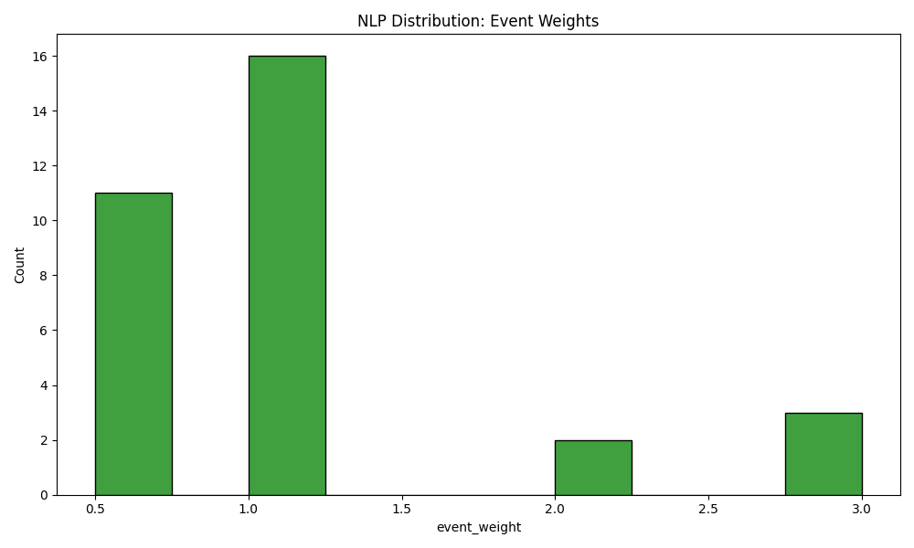
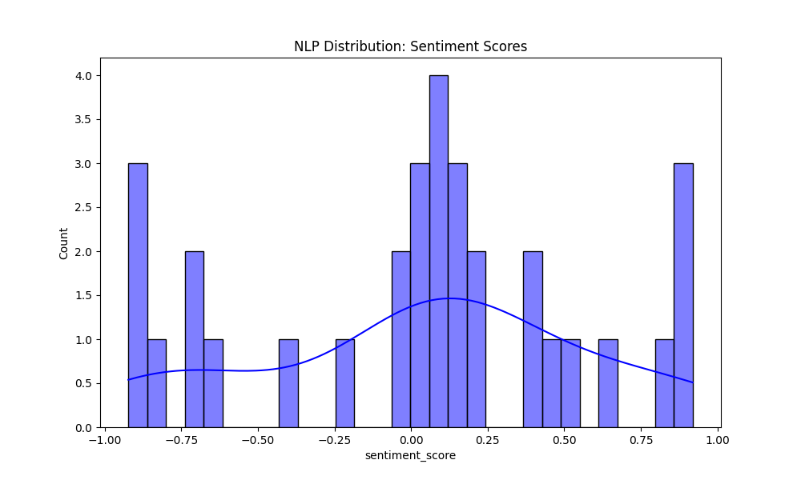

# NLP Validation Report

This report summarizes the current NLP sentiment pipeline and the latest available validation snapshot.

For the full architecture and runtime explanation, see:

```text
services/models/nlp/docs/nlp_pipeline_report.md
```

## What The NLP Pipeline Does

The NLP module fetches crypto/Solana news, cleans and filters article text, scores it with FinBERT, detects event type, applies event impact weights, and aggregates everything into 15-minute sentiment features.

It does not place trades and it does not decide UP/DOWN alone. The classification model consumes the aggregated sentiment features together with market, technical, and orderbook features.

## Automatic Rerun Behavior

The NLP scripts are one-shot scripts.

They run once and exit:

```bash
python services/models/nlp/src/main.py
python services/models/classification/realtime_sentiment_fetcher.py
```

`GDELT_FETCH_INTERVAL_MINUTES=5` means "fetch articles seen in the last 5 minutes." It does not mean "run this script automatically every 5 minutes."

Recommended scheduler:

```text
NLP sentiment fetcher: every 5 minutes
Classification pipeline: every 15 minutes after candle close
```

## Runtime Outputs

Offline NLP pipeline:

```text
services/models/nlp/data/processed/processed_articles.csv
services/models/nlp/data/processed/sentiment_features_15m.csv
```

Realtime classifier bridge:

```text
services/models/classification/data/realtime/latest_sentiment_15m.csv
services/models/classification/data/realtime/processed_urls.txt
```

Static HTML dashboard:

```bash
python services/models/nlp/22_nlp_sentiment_dashboard.py
```

```text
services/models/nlp/reports/nlp_sentiment_dashboard.html
```

Open the generated HTML file in a browser to inspect latest sentiment, bucket trends, event distribution, and top article signals.

## Validation Snapshot

Generated on: 2026-04-30 14:19:24.997617

Total articles analyzed: 32

Observed sources:

```text
rss
```

## High-Signal Articles

These articles had the largest absolute event-weighted sentiment signals in the latest validation snapshot.

| title | event_type | event_weight | sentiment_score | event_signal |
|:---|:---|---:|---:|---:|
| Should users be allowed to bet on war and death in prediction markets? | hack/security | 3 | -0.923022 | -2.76907 |
| Crypto hack losses top $630M in April, highest since February 2025 | hack/security | 3 | -0.805241 | -2.41572 |
| AI-driven hacks could kill DeFi - unless projects act now | hack/security | 3 | -0.622583 | -1.86775 |
| South Korea's Shinhan Card taps Solana to test real-world stablecoin payments | partnership | 2 | 0.799595 | 1.59919 |
| XRP hints at 30% spike, Bitcoin ETFs post 9-day inflow streak: Hodler's Digest, April 19 - 25 | ETF/regulation | 1 | 0.906847 | 0.906847 |
| US, UAE and China joint effort dismantles 9 crypto scam centers | ETF/regulation | 1 | -0.882085 | -0.882085 |
| Bitcoin falls as traders cut risk ahead of FOMC: Will TradFi, spot ETF volumes bolster $70K support? | ETF/regulation | 1 | -0.874325 | -0.874325 |
| Bitcoin futures signal caution as long-to-short ratio signals positioning shift | whale | 2 | -0.376289 | -0.752578 |
| US seized $500M in Iranian crypto assets, Treasury secretary says | ETF/regulation | 1 | -0.684872 | -0.684872 |
| Bitcoin 'on track' for $90K, ETFs pull in nearly $1B: Hodler's Digest, April 12 - 18 | ETF/regulation | 1 | 0.657987 | 0.657987 |

## Event Distribution

| event_type | count |
|:---|---:|
| ETF/regulation | 16 |
| general | 11 |
| hack/security | 3 |
| partnership | 1 |
| whale | 1 |

High-impact events detected: 5



## Sentiment Distribution

| sentiment_label | count |
|:---|---:|
| neutral | 17 |
| negative | 8 |
| positive | 7 |



## Validation Notes

The snapshot only contains RSS articles, so it does not prove that GDELT is always available. GDELT should be monitored separately because rate limits, empty responses, and upstream delays are common.

The snapshot is useful for checking that FinBERT output, event weighting, and report generation work, but trading reliability must be judged with out-of-sample classifier performance.

Run the tests with:

```bash
python -m pytest services/models/nlp/tests
```
